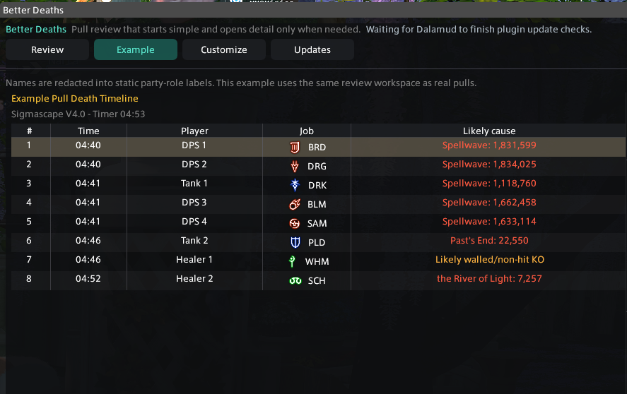
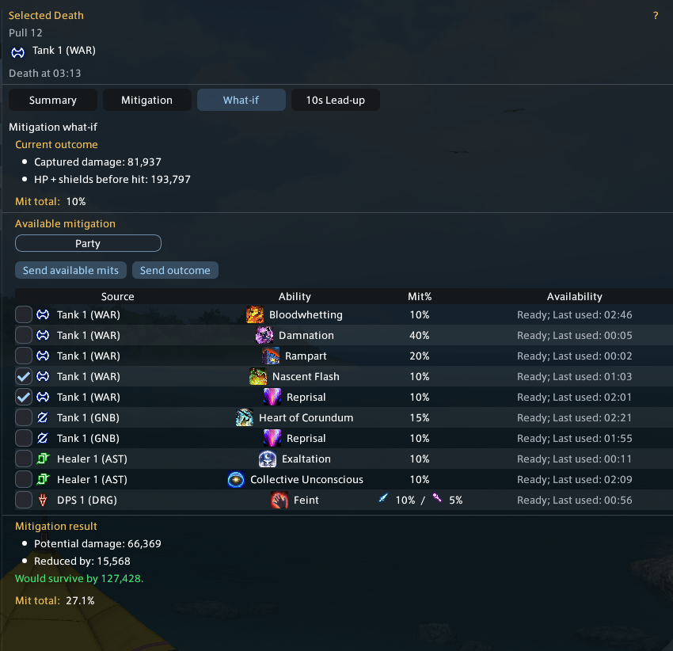
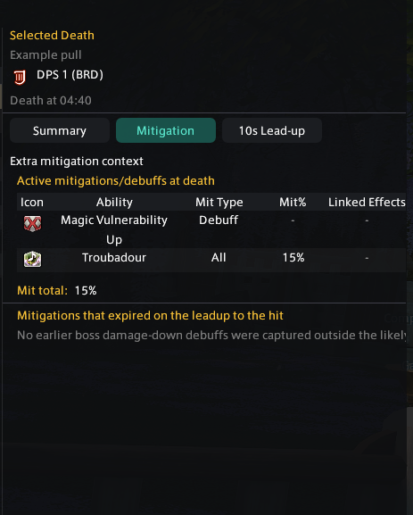
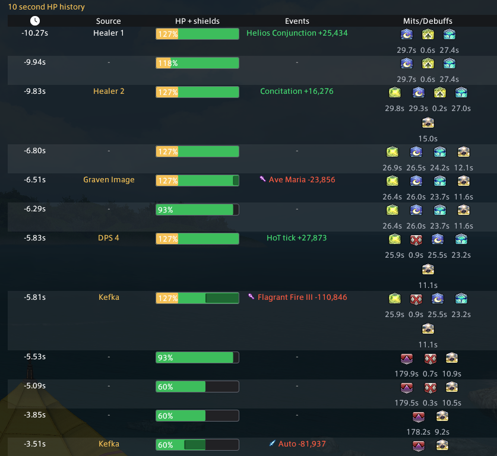
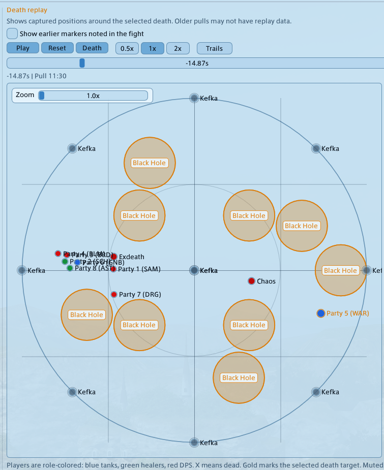
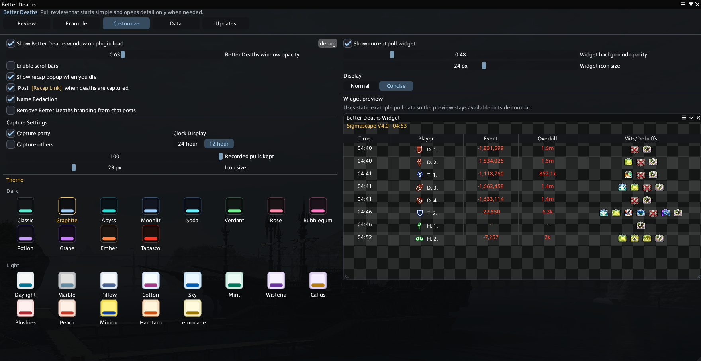

# Better Deaths

Better Deaths is a Dalamud plugin for reviewing FFXIV deaths with pull-level context, tracking damage, and watching party cooldowns.

Website: https://nainaiowo.github.io/better-deaths/

It helps you review:

- party-wide death order by pull
- fatal events, captured hit details, and overkill context
- HP plus shields before the fatal event
- active player mitigations, shields, debuffs, and target mitigation
- configurable 10-second, 30-second, or 1-minute HP history with source, event, and status snapshots
- What-if mitigation checks using available party tools
- a customizable DPS Meter with live damage, ability breakdowns, and saved encounters
- optional cooldown icons alongside the native party list, customized per job
- Death Replay, IN BETA, with captured positions, markers, mechanics, and replay controls
- current pull review, the Death Window, themes, name redaction, and saved pull history

## What It Does

Better Deaths is built around fast raid review. It keeps deaths grouped by pull, shows the timeline in death order, and opens each player into the details that matter for figuring out what happened.

It also includes:

- fatal event summaries with source, action, amount, damage type, and enemy HP at death
- HP plus shields before the fatal event, including shield and HP movement in the lead-up
- mitigation review with active effects, expired context, and calculated mitigation total
- What-if mitigation review for checking how selected available mits would have changed the hit
- configurable 10-second, 30-second, or 1-minute lead-up history with captured events, heals, hits, sources, and status timers
- Death Replay, IN BETA, for reviewing captured movement and mechanics around a selected death
- current pull review and an optional Death Window with Normal and Concise display modes
- a live DPS Meter with selectable columns and a saved-encounter preview
- Party Cooldowns with per-job selections and separate saved left/right layouts
- multiple themes, widget opacity controls, optional scrollbars, and name redaction
- locally saved pull history that remains available after wipes
- chat posts for a selected channel with optional recap links for participating Better Deaths users

## HUD: Party Cooldowns

Open `/bd` and select **HUD > Party Cooldowns**. Check **Show party cooldowns** to place ability icons beside the game's party-list names. It is optional and starts disabled.

- Expand Tanks, Healers, Melee, or Ranged, then a job. Choose up to 12 damage, defensive, healing, and support cooldowns for each job.
- **Auto-collapse other jobs**, beside the visibility checkbox, keeps only the focused job and role open. It applies to job headers and the preview dropdown; turn it off to keep multiple sections expanded.
- Click `+` or drag available abilities into the selection. Drag to reorder; use `X` to remove. Existing selections are not replaced when more choices are added.
- Place the icons left or right of names. Each side saves its own 16-72 px icon size, spacing, and offsets; ability selections remain per job.
- Enable **Custom rows** inside a job, above **Selected cooldowns**, to assign its abilities to up to three rows. Use the small `+` to add a row, then drag abilities into it. Select a row to make it the destination for clicked `+` abilities. The 12-ability limit is shared across all rows.
- Custom rows are shared between left/right placement. Turning the checkbox off shows one row and remembers the arrangement for next time; empty additional rows can be removed.
- Use the non-scrolling preview outside combat. Its sample party frame and selected icons shrink together only when needed to fit; the preview percentage does not change your live settings. HP/MP and timers are examples, not live party readings.
- Countdown and charge numbers have black outlines for readability over ability icons.
- Read countdowns and available charges. `?` means cooldown history is unknown. A ready cooldown does not guarantee the required MP, gauge, buff, target, or equipped limited-job spell.
- Timers continue through ordinary combat endings and follow confirmed duty resets. Tempera Coat and Grassa use confirmed shield breaks for their 60- and 30-second reductions.

Teammate timers depend on captured uses and level-aware recharge rules. Abilities with unhandled proc reductions or resets remain greyed out with an explanation. Routine shared-GCD attacks, resource-only spenders, and consumed follow-ups are not separate cooldown choices. The overlay follows the native party list, not separate alliance-party panels, and does not change What-if or damage capture.

**HUD** also contains **DPS Meter** and **Death Window**. Select **Walkthrough** in the main header for an in-game tour, or read the [Party Cooldowns help page](https://nainaiowo.github.io/better-deaths/help/cooldowns.html#party-cooldowns).

## Privacy And Data

Better Deaths does not upload your data. It has no upload functions, telemetry, analytics, webhook, feedback endpoint, or hidden network reporting built into the plugin.

Recorded pulls are saved locally so you can review them after wipes, resets, reloads, or plugin updates. Saved pull files can include player names, jobs, duty names, death timing, HP, shields, damage events, actions, statuses, and mitigation context.

Name Redaction helps with screenshots and shared display, but local saved pull files may still contain the original captured names.

## Screenshots

### Death Timeline



### What-if Mitigation



### Mitigation Context



### Configurable Lead-Up



### Death Replay (IN BETA)



### Themes And Widget Preview



## Commands

```text
/betterdeaths
/bd
/bdw
/bdm
/bdr
```

`/bdw` toggles the Death Window. `/bdm` toggles the DPS Meter widget without stopping capture or resetting the encounter.

`/bdr` resets the active DPS meter encounter in the overworld, saving the result before starting fresh on the next damage. It is unavailable inside duties and does not delete saved encounters.

## Dalamud Repository

Add this custom plugin repository URL in Dalamud:

```text
https://puni.sh/api/repository/nainai
```

Then install `Better Deaths` from Dalamud's plugin installer.

## Notes

Death recap capture works inside duties. The DPS Meter also records overworld combat. PvP capture is not supported.

This is a work in progress raid review tool, so feedback and issue reports are welcome.
